# recall

Search your AI chat history from the terminal. recall reads the history of
pi, Claude Code, Codex, Cursor and Cursor Agent, and finds a past
conversation in milliseconds.


## How it works



1. `recall index` reads only the new lines of each session file.
2. One writer adds them to a local SQLite FTS5 index.
3. `recall find` ranks the hits with BM25 in about 40 ms.
4. `recall show` reads the full session again from its source.

recall reads each tool's own files and does not change them. It keeps one
search index at `~/.recall/index.sqlite`. You can delete the index at any
time and build it again.

## Install

Use one of these commands:

```bash
brew install pratikgajjar/tap/recall
curl -fsSL https://raw.githubusercontent.com/pratikgajjar/recall/main/install.sh | sh
go install github.com/pratikgajjar/recall@latest
```

Prebuilt binaries for macOS and Linux are on the
[releases page](https://github.com/pratikgajjar/recall/releases). recall is
one static Go binary. It does not need CGO.

## Quick start

```bash
recall index                 # build the index (about 1 minute for 6,000 sessions)
recall doctor                # show the sources that recall found
recall "flaky checkout test" # search
```

## Use recall with an agent

An agent uses the same CLI that you use. recall has no server and no tool
schema. A skill file tells the agent which commands to run.

| Agent | Setup |
|---|---|
| pi | `pi install npm:@pratikgajjar/pi-recall` ([details](packages/pi-recall)) |
| Claude Code | `recall skill install ~/.claude/skills/recall` |
| Other skill systems | `npx skills add pratikgajjar/recall` |
| Any agent with a shell | Tell the agent to read `recall --help` |

The binary contains the skill file. `recall skill install DIR` writes it to
DIR. Without DIR, the command updates each copy that is already installed.
`recall doctor` shows a copy that is older than the binary.

Then ask the agent a question about earlier work. For example: _"Use recall
to find how we fixed the flaky checkout test."_

## Commands

```
recall <query>                     search; show ranked hits (alias: find)
recall last [--repo P]             show the most recent matching session
recall show <session-id>           show one session, read again from its source
recall sessions                    list sessions without their messages
recall related <session-id>        find sessions about the same topic
recall open <session-id>           open the session in its own tool
recall tag <session-id|.> <tag>... add tags (. = the current pi session)
recall tag -d <session-id> <tag>...  remove tags
recall tag [-l]                    list tags and their counts
recall stats                       sessions, messages, tokens and cost
recall index [--full] [--prune]    update the index
recall memory|skill [terms]        search memory or skill files; an exact title shows the file
recall plugin list|install|test    manage Lua plugins
recall skill install [DIR]         install or update the agent skill
recall doctor                      show sources, index size and skill status
```

### Search flags

You can put a flag anywhere on the command line.

| Flag | Effect |
|---|---|
| `--repo PATH` | Search one project and its subfolders. `.` is the Git repository of the current directory. |
| `--in SESSION-ID` | Search one session. `.` is the current pi session. |
| `--after WHEN`, `--since WHEN` | Sessions that started after WHEN: `7d`, `YYYY-MM-DD` or epoch milliseconds. |
| `--before WHEN` | Sessions that started before WHEN. |
| `--tag TAG` | Sessions with this tag. Repeat the flag to require all tags. `source:<id>` selects one source, for example `source:pi` or `source:docs`. |
| `--context N` | Show N messages before and after each hit. |
| `--limit N` | Show at most N hits. The default is 30. |
| `--json` | Write JSON. |

Text output ends with `next:` and `prev:` lines. Each line is a complete
command for the next page of results.

### Read a long session

Some sessions have thousands of messages. Do not read all of them.

1. To find a topic in a session, search the session:
   `recall "pool timeout" --in pi:019f... --context 3`.
2. To see the structure of a session, use `recall show <id> --outline`.
   The outline shows one line for each turn. It shows a run of tool calls
   as one line.
3. To read part of a session, use `--range`. The value is a Python slice:
   `305:315`, `:50` or `-50:`.
4. To remove tool output, use `--role user,assistant`.

Each message has a `## N role` header, so each part of a session shows its
position. Output has limits. A session with more than 200 messages shows the
outline first. A read stops at 20,000 characters and tells you the next
range. A tool result stops at 600 characters. Use `--tool-chars 0` to see all
of it.

### Tags

A tag marks a session so that you can find it again. Tags are in their own
table. `recall index --full` does not remove them.

```bash
recall tag . deploy-rca                     # tag the current pi session
recall tag claude:94b0155c-... deploy-rca   # tag a session by its id
recall sessions --tag deploy-rca            # list the tagged sessions
recall sessions --tag deploy-rca --tag source:pi
```

`source:` is a reserved prefix. recall sets it from the session. You cannot
add it as a tag.

`.` uses the `PI_SESSION_ID` variable that pi sets. If the variable is not
set, give the session id.

### Tokens and cost

`recall stats` shows sessions, messages, tokens and cost by source, project
and model.

```
$ recall stats --projects 2 --models 3
SOURCE  SESSIONS  MESSAGES  TOKENS  COST        PROJECT
pi      686       313807    31.3B   $17190.19   (all)
        20        69379     5.7B    $2701.57      ~/code/ledger
        187       68149     6.7B    $2273.09      ~/code/api-server
codex   1088      37493     771.4M  -           (all)

MODEL                SOURCE  SESSIONS  TOKENS  CACHED  COST
claude-opus-4-8      pi      192       8.2B    96%     $6687.34
claude-opus-4-7      pi      122       7.2B    96%     $2732.05
gpt-5.6-sol          codex   18        415.5M  93%     -
```

recall does not have a price list. It shows only the values that each tool
wrote:

| Source | Model | Tokens | Cost |
|---|---|---|---|
| pi | `message.model` | `usage` of each message, added together | `usage.cost.total` |
| codex | `turn_context.model` | last `token_count` total | not recorded |
| cursor | `modelConfig.modelName` | `contextTokensUsed` | `usageData.costInCents` |
| claude, cursor-agent, plugins | not recorded | estimate | not recorded |

An estimate starts with `~`. recall calculates it from the length of the
text. A `-` means that the source does not record the value.

`recall stats --csv usage-` writes `usage-projects.csv` and
`usage-models.csv`. The files contain raw numbers and an `estimated` column.
All filters apply. Row limits do not apply.

## Sources

| Tool | Files | Notes |
|---|---|---|
| pi | `~/.pi/agent/sessions/<cwd>/*.jsonl` | Append-only JSONL. recall reads only the new lines. |
| Claude Code | `~/.claude/projects/<cwd>/*.jsonl` | Append-only JSONL. |
| Codex CLI | `~/.codex/sessions/YYYY/MM/DD/rollout-*.jsonl` | Append-only JSONL. |
| Cursor | `~/Library/Application Support/Cursor/User/globalStorage/state.vscdb` | SQLite, opened read-only. `workspaceStorage` gives the project folder. |
| Cursor Agent CLI | `~/.cursor/projects/<slug>/agent-transcripts/<id>/<id>.jsonl` | No timestamps in the file, so recall uses the file time. |

To index another source, add a Lua plugin. See [Index anything](#index-anything).

## The index

recall stores the index at `~/.recall/index.sqlite`. Set `RECALL_INDEX` to use
a different file.

- **Search.** SQLite FTS5 with BM25 ranking. The first 1,500 bytes of a
  message have full weight. recall indexes the remainder in windows with less
  weight. Thus recall also finds text deep in a long message.
- **Updates.** `recall index` reads only the new lines of each changed
  file. When nothing changed, a run takes about 50 ms. The pi extension runs
  it after each agent turn.
- **Concurrent runs.** A lock file lets only one `recall index` write at a
  time. A second run waits, then indexes only the remaining changes.
- **Maintenance.** FTS5 keeps deleted rows until it merges the index. recall
  counts the deleted rows. When they are more than 10% of the live rows,
  recall merges the index and returns the free space to the disk. It also
  does this after `--full`. You do not have to run `VACUUM`.
- **Removed sessions.** `recall index --full --prune` removes sessions that
  are no longer in their source.

Measured on one Apple silicon laptop with 6,060 sessions and 1.1 million
indexed rows:

| Operation | Time |
|---|---|
| Search, median | 38 ms |
| Search, p95 | 68 ms |
| `recall index`, no changes | 55 ms |
| `recall index --full` | 70 s |
| Index size | 1.5 GB |

## Index anything



recall is not limited to chat history. It indexes any data that you can
change into a list of text records. All sources use one contract:

| Part | Fields | Purpose |
|---|---|---|
| Session | `id`, `title`, `project`, `started_at` | One unit to find and open: a chat, a note, a document |
| Message | `role`, `ts`, `text` | One searchable record in the session |
| Checkpoint | opaque string | The point where the next scan continues |

The built-in adapters for pi, Claude Code, Codex and Cursor are Go code that
makes this contract. A Lua plugin makes the same contract without a new build
of recall. `recall memory` and `recall skill` are Lua plugins.

Each source that makes the contract gets these functions from recall:

- BM25 search with `recall find`, with the same ranking as the chat sources
- Incremental scans: recall reads only new lines or changed files
- `show`, `related`, `tags`, `--repo`, `--json` and `stats`
- A `source:<id>` facet, for example `--tag source:docs`

### Write a plugin

This plugin makes each Markdown file under `~/code` searchable. Save it as
`~/.recall/plugins/docs.lua`:

```lua
return {
  id = "docs",
  kind = "file",
  roots = { "~/code" },
  glob = "*.md",
  resume = "file://{id}",

  file = function(doc)
    local title = doc.text:match("^#%s+([^\n]+)") or doc.basename
    local session = { id = doc.path, project = doc.dir, title = title, started_at = doc.mtime }
    return session, { { role = "doc", ts = doc.mtime, text = doc.text } }
  end,
}
```

Then test it, index and search:

```bash
recall plugin test ~/.recall/plugins/docs.lua ~/code/api/docs/runbook.md
recall index
recall "rotate postgres password" --tag source:docs
```

recall does not go into `.git`, `node_modules` or `vendor` directories.

### Plugin kinds

| Kind | Input | recall calls | Resume |
|---|---|---|---|
| `line` | A JSONL file | `line(line, st)` for each line. `st` keeps state for the file. | Byte offset. recall reads only new lines. |
| `file` | A whole file | `file(doc)` one time for each changed file | File size and time |
| `kv` | A SQLite key/value table | `session(id, header, related_rows, st)` one time for each session | An integer `watermark` column. Without one, a full scan. |

A plugin can also set `model`, `tokens_in`, `tokens_out`, `cache_read`,
`cache_write` and `cost_usd`. Then `recall stats` shows real usage for the
source.

### Helpers

A plugin does not parse JSON or time itself. Go does this work:

| Helper | Result |
|---|---|
| `recall.get(bytes, "a.b[0].c")` | One value from JSON, by path |
| `recall.json(bytes)` | The full JSON value as a Lua table |
| `recall.lines(s)` | An array of lines |
| `recall.time(s [, fmt])` | Unix milliseconds. `fmt` is `rfc3339`, `unix_ms`, `unix_s` or a Go layout. |
| `recall.truncate(s, n)` | `s`, cut to `n` bytes |

### Safety

recall runs each plugin in a Lua VM without the `os`, `io`, `package` and
network functions. A plugin cannot read files, run commands or connect to a
network. If a plugin runs for more than 60 s on one file, recall stops it,
skips that file and continues. If a plugin fails to load, recall skips the plugin and
indexes the other sources.

### Manage plugins

```bash
recall plugin list                 # show bundled and installed plugins
recall plugin install obsidian     # copy a bundled plugin to ~/.recall/plugins
recall plugin test my.lua sample   # show the records that a plugin makes from a file
```

Bundled plugins: `obsidian`, `memory`, `skill`, and Lua versions of `pi`,
`claude`, `codex`, `cursor` and `cursor-agent`. A plugin with the same `id` as
a built-in adapter replaces it. Use this to change a source without a new
build. Tests check that the Lua versions of `pi`, `claude`, `codex` and
`cursor` give the same records as the Go adapters.

See [`plugins/`](plugins/) for examples and
[`architecture.md`](architecture.md) for the full contract.

## Design

- **Read-only.** The source files stay the source of truth.
- **No copies.** The index contains only text for search and session data.
  `show` reads the session again from its source.
- **One binary.** One Go executable, about 13 MB, without CGO.
- **One interface.** Each source implements the `Adapter` interface in
  `types.go`.

[`autoresearch.md`](autoresearch.md) records how the search and index
behaviour was measured, and the experiments that failed.

## Licence

MIT.
