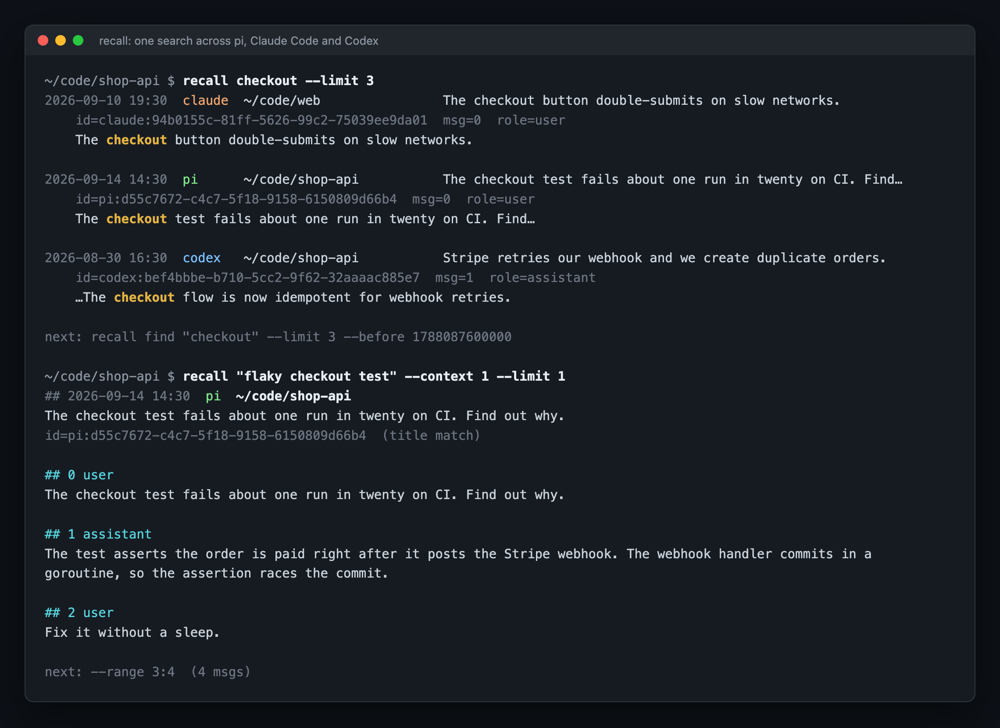

# recall

Search your AI chat history from the terminal. recall reads the history of
pi, Claude Code, Codex, Cursor and Cursor Agent, and finds a past
conversation in milliseconds.



recall reads each tool's own files and does not change them. It keeps one
search index at `~/.recall/index.sqlite`. You can delete the index at any
time and build it again.

## Install

Use one of these commands:

```bash
brew install pratikgajjar/tap/recall
curl -fsSL https://raw.githubusercontent.com/pratikgajjar/recall/main/install.sh | sh
go install github.com/pratikgajjar/recall@latest
```

Prebuilt binaries for macOS and Linux are on the
[releases page](https://github.com/pratikgajjar/recall/releases). recall is
one static Go binary. It does not need CGO.

## Quick start

```bash
recall index                 # build the index (about 1 minute for 6,000 sessions)
recall doctor                # show the sources that recall found
recall "flaky checkout test" # search
```

## Use recall with an agent

An agent uses the same CLI that you use. recall has no server and no tool
schema. A skill file tells the agent which commands to run.

| Agent | Setup |
|---|---|
| pi | `pi install npm:@pratikgajjar/pi-recall` ([details](packages/pi-recall)) |
| Claude Code | `recall skill install ~/.claude/skills/recall` |
| Other skill systems | `npx skills add pratikgajjar/recall` |
| Any agent with a shell | Tell the agent to read `recall --help` |

The binary contains the skill file. `recall skill install DIR` writes it to
DIR. Without DIR, the command updates each copy that is already installed.
`recall doctor` shows a copy that is older than the binary.

Then ask the agent a question about earlier work. For example: _"Use recall
to find how we fixed the flaky checkout test."_

## Commands

```
recall <query>                     search; show ranked hits (alias: find)
recall last [--repo P]             show the most recent matching session
recall show <session-id>           show one session, read again from its source
recall sessions                    list sessions without their messages
recall related <session-id>        find sessions about the same topic
recall open <session-id>           open the session in its own tool
recall tag <session-id|.> <tag>... add tags (. = the current pi session)
recall tag -d <session-id> <tag>...  remove tags
recall tag [-l]                    list tags and their counts
recall stats                       sessions, messages, tokens and cost
recall index [--full] [--prune]    update the index
recall memory|skill [terms]        search memory or skill files; an exact title shows the file
recall plugin list|install|test    manage Lua plugins
recall skill install [DIR]         install or update the agent skill
recall doctor                      show sources, index size and skill status
```

### Search flags

You can put a flag anywhere on the command line.

| Flag | Effect |
|---|---|
| `--repo PATH` | Search one project and its subfolders. `.` is the Git repository of the current directory. |
| `--in SESSION-ID` | Search one session. `.` is the current pi session. |
| `--after WHEN`, `--since WHEN` | Sessions that started after WHEN: `7d`, `YYYY-MM-DD` or epoch milliseconds. |
| `--before WHEN` | Sessions that started before WHEN. |
| `--tag TAG` | Sessions with this tag. Repeat the flag to require all tags. `source:pi` selects one source. |
| `--context N` | Show N messages before and after each hit. |
| `--limit N` | Show at most N hits. The default is 30. |
| `--json` | Write JSON. |

Text output ends with `next:` and `prev:` lines. Each line is a complete
command for the next page of results.

### Read a long session

Some sessions have thousands of messages. Do not read all of them.

1. To find a topic in a session, search the session:
   `recall "pool timeout" --in pi:019f... --context 3`.
2. To see the structure of a session, use `recall show <id> --outline`.
   The outline shows one line for each turn. It shows a run of tool calls
   as one line.
3. To read part of a session, use `--range`. The value is a Python slice:
   `305:315`, `:50` or `-50:`.
4. To remove tool output, use `--role user,assistant`.

Each message has a `## N role` header, so each part of a session shows its
position. Output has limits. A session with more than 200 messages shows the
outline first. A read stops at 20,000 characters and tells you the next
range. A tool result stops at 600 characters. Use `--tool-chars 0` to see all
of it.

### Tags

A tag marks a session so that you can find it again. Tags are in their own
table. `recall index --full` does not remove them.

```bash
recall tag . deploy-rca                     # tag the current pi session
recall tag claude:94b0155c-... deploy-rca   # tag a session by its id
recall sessions --tag deploy-rca            # list the tagged sessions
recall sessions --tag deploy-rca --tag source:pi
```

`source:` is a reserved prefix. recall sets it from the session. You cannot
add it as a tag.

`.` uses the `PI_SESSION_ID` variable that pi sets. If the variable is not
set, give the session id.

### Tokens and cost

`recall stats` shows sessions, messages, tokens and cost by source, project
and model.

```
$ recall stats --projects 2 --models 3
SOURCE  SESSIONS  MESSAGES  TOKENS  COST        PROJECT
pi      686       313807    31.3B   $17190.19   (all)
        20        69379     5.7B    $2701.57      ~/code/ledger
        187       68149     6.7B    $2273.09      ~/code/api-server
codex   1088      37493     771.4M  -           (all)

MODEL                SOURCE  SESSIONS  TOKENS  CACHED  COST
claude-opus-4-8      pi      192       8.2B    96%     $6687.34
claude-opus-4-7      pi      122       7.2B    96%     $2732.05
gpt-5.6-sol          codex   18        415.5M  93%     -
```

recall does not have a price list. It shows only the values that each tool
wrote:

| Source | Model | Tokens | Cost |
|---|---|---|---|
| pi | `message.model` | `usage` of each message, added together | `usage.cost.total` |
| codex | `turn_context.model` | last `token_count` total | not recorded |
| cursor | `modelConfig.modelName` | `contextTokensUsed` | `usageData.costInCents` |
| claude, cursor-agent, plugins | not recorded | estimate | not recorded |

An estimate starts with `~`. recall calculates it from the length of the
text. A `-` means that the source does not record the value.

`recall stats --csv usage-` writes `usage-projects.csv` and
`usage-models.csv`. The files contain raw numbers and an `estimated` column.
All filters apply. Row limits do not apply.

## Sources

| Tool | Files | Notes |
|---|---|---|
| pi | `~/.pi/agent/sessions/<cwd>/*.jsonl` | Append-only JSONL. recall reads only the new lines. |
| Claude Code | `~/.claude/projects/<cwd>/*.jsonl` | Append-only JSONL. |
| Codex CLI | `~/.codex/sessions/YYYY/MM/DD/rollout-*.jsonl` | Append-only JSONL. |
| Cursor | `~/Library/Application Support/Cursor/User/globalStorage/state.vscdb` | SQLite, opened read-only. `workspaceStorage` gives the project folder. |
| Cursor Agent CLI | `~/.cursor/projects/<slug>/agent-transcripts/<id>/<id>.jsonl` | No timestamps in the file, so recall uses the file time. |

To index another source, add a Lua plugin. See [Lua plugins](#lua-plugins).

## The index

recall stores the index at `~/.recall/index.sqlite`. Set `RECALL_INDEX` to use
a different file.

- **Search.** SQLite FTS5 with BM25 ranking. The first 1,500 bytes of a
  message have full weight. The remainder of the message is indexed in
  windows with less weight, so text deep in a long message is also found.
- **Updates.** `recall index` reads only the new lines of each changed
  file. When nothing changed, a run takes about 50 ms. The pi extension runs
  it after each agent turn.
- **Concurrent runs.** A lock file lets only one `recall index` write at a
  time. A second run waits, then indexes only the remaining changes.
- **Maintenance.** FTS5 keeps deleted rows until it merges the index. recall
  counts the deleted rows. When they are more than 10% of the live rows, or
  after `--full`, recall merges the index and returns the free space to the
  disk. You do not have to run `VACUUM`.
- **Removed sessions.** `recall index --full --prune` removes sessions that
  are no longer in their source.

Measured on one Apple silicon laptop with 6,060 sessions and 1.1 million
indexed rows:

| Operation | Time |
|---|---|
| Search, median | 38 ms |
| Search, p95 | 68 ms |
| `recall index`, no changes | 55 ms |
| `recall index --full` | 70 s |
| Index size | 1.5 GB |

## Lua plugins

A Lua plugin adds a source without a new build of recall. recall does all of
the file and database I/O. The plugin only changes bytes into sessions and
messages. The plugin cannot open files, run commands or use the network.

```bash
recall plugin list                 # show bundled and installed plugins
recall plugin install obsidian     # copy a bundled plugin to ~/.recall/plugins
recall plugin test my.lua sample   # show the records that a plugin makes from a file
recall index                       # index the new source
```

recall loads each `~/.recall/plugins/*.lua` file when it indexes. If a plugin
fails, recall skips it and continues. A plugin can be one of three kinds:
`line` (JSONL), `file` (one document) or `kv` (a SQLite key/value table).

See [`plugins/`](plugins/) for examples and
[`architecture.md`](architecture.md) for the plugin contract.

## Design

- **Read-only.** The source files stay the source of truth.
- **No copies.** The index contains only text for search and session data.
  `show` reads the session again from its source.
- **One binary.** One Go executable, about 13 MB, without CGO.
- **One interface.** Each source implements the `Adapter` interface in
  `types.go`.

[`autoresearch.md`](autoresearch.md) records how the search and index
behaviour was measured, and the experiments that failed.

## Licence

MIT.
