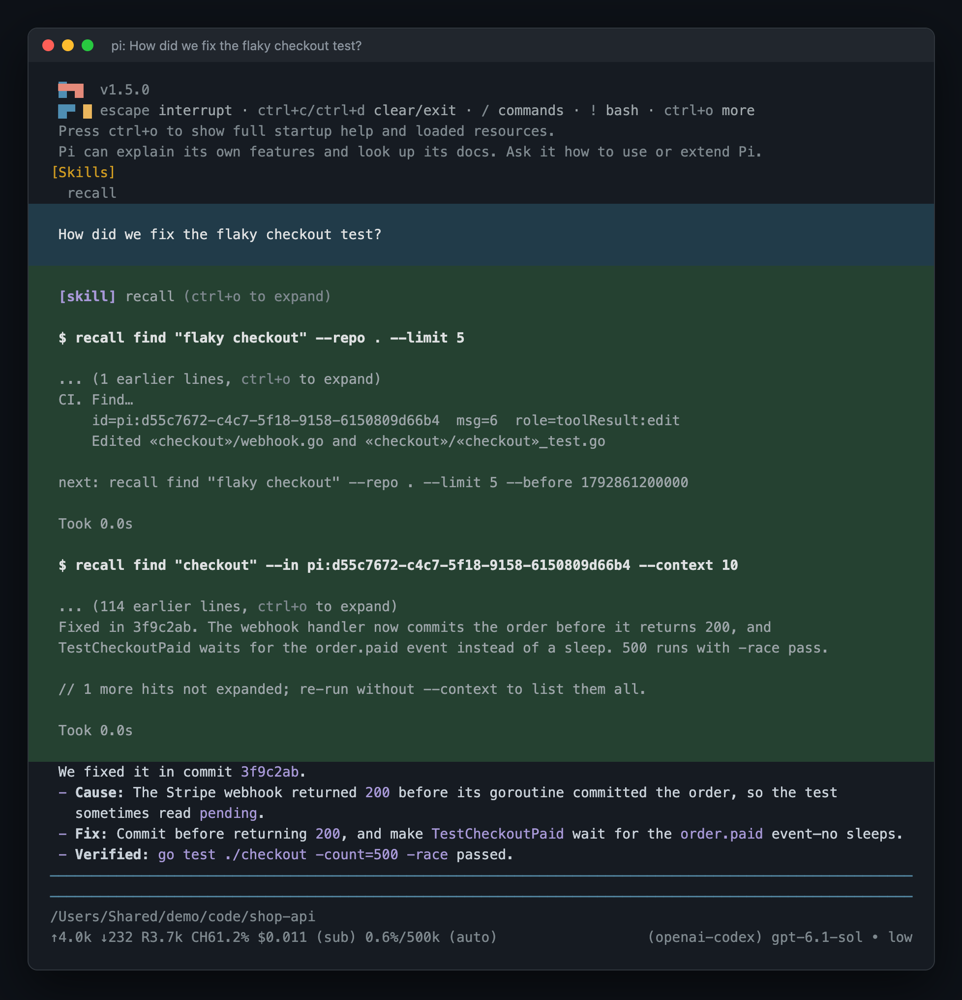

# pi-recall

A [pi](https://github.com/badlogic/pi-mono) extension for
[recall](https://github.com/pratikgajjar/recall). With it, a pi agent can find
and read your past AI sessions from pi, Claude Code, Codex and Cursor. You do
not have to copy and paste transcripts.



_A real pi session on a synthetic demo history. The agent runs `recall find`,
reads the matching messages, and answers with the commit._

## Install

```bash
pi install npm:@pratikgajjar/pi-recall
```

The package contains the `recall` binary for your platform. `pi update`
updates the extension and the binary together. The extension uses the first
binary that it finds in this order:

1. The `--recall-bin` flag.
2. The `RECALL_BIN` environment variable.
3. The binary in this package.
4. `recall` on your `PATH`.

Build the index one time:

```bash
recall index    # about 1 minute for 6,000 sessions
recall doctor   # show the sources that recall found
```

To load the extension from a source checkout:

```bash
pi -e ./packages/pi-recall/src/index.ts
```

## What the extension does

- At session start, it installs the recall skill and updates the index.
- After each agent turn, it updates the index in the background. The current
  session is then searchable.
- It adds the `/recall-health` and `/recall-index` commands.

The extension registers no tools. The agent runs the CLI from its shell tool,
and the skill tells it which commands to use:

```bash
recall "connection pool timeout" --limit 5          # search
recall show pi:019f... --range 300:340              # read part of a session
recall "pool timeout" --in pi:019f... --context 5   # search one session and read the hits
```

A tool schema goes to the model on each turn, also when the agent does not use
it. The skill goes to the model only when a task needs it.

## Read a long session

Some sessions have thousands of messages. To find a topic in one session,
search the session:

```bash
recall "connection pool timeout" --in pi:019f... --context 5
```

This is one command. Measured on real agent work, a search in a session
returned about 400 characters, and an outline about 4,000. `--in .` searches
the current session. Use it to find text from before a compaction.

Use the outline only for a session that you know nothing about. These
`recall show` flags select part of a session:

- `--range FROM:TO` is a Python slice: `:100` is the first 100 messages,
  `-50:` is the last 50, `305:315` is a window.
- `--outline` shows one line for each turn. A run of tool calls is one line,
  for example `[12-38] tool ×27 (4.2k chars: bash×19, read×8)`. A long session
  shows only the user turns.
- `--role user,assistant` removes tool output. In long agent sessions, tool
  messages are often half of all messages or more.

Each message has a `## N role` header. Output has limits, and it always tells
you how to get the rest:

- A session with more than 200 messages shows the outline first.
- A read stops at 20,000 characters and shows the next `--range`.
- A tool result stops at 600 characters. `--tool-chars 0` shows all of it.

After a hit at message N, read `--range N-5:N+5`, or search with
`--context 5`.

## Agent instructions

Add this text to the `AGENTS.md` or `CLAUDE.md` file of your project:

```markdown
When the user refers to earlier work ("how did we fix…", "continue the…"),
use recall to find and read the past AI session first.
```

## Index updates

`recall index` reads only the new lines of each changed session file. When
nothing changed, a run takes about 50 ms. The extension runs it at session
start, and 1.5 s after each agent turn. If two runs start at the same time,
the second run waits for the first.

To stop the background updates, set `--recall-auto-index=false` or
`RECALL_AUTO_INDEX=0`. Then use `/recall-index` to update the index.

## Commands

| Command | Effect |
|---|---|
| `/recall-health` | Runs `recall doctor`: the CLI version, the sources and the index size. |
| `/recall-index` | Runs `recall index`. Add `--full` to index all sessions again. |

## Configuration

| Setting | Effect |
|---|---|
| `--recall-bin PATH` or `RECALL_BIN` | The path to the `recall` binary. |
| `--recall-auto-index=false` or `RECALL_AUTO_INDEX=0` | Stops the background index updates. They are on by default. |

## Licence

MIT.
